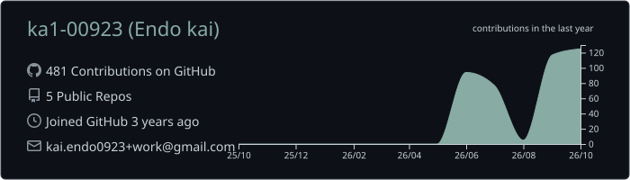

# Kai Endo / ichika9023

**Software Engineer / Creator**  
Building software, exploring systems, and creating digital experiences.

### Activity

  <picture>
    <source
      media="(prefers-color-scheme: dark)"
      srcset="./profile-summary-card-output/custom_dark/0-profile-details.svg"
    />
    <source
      media="(prefers-color-scheme: light)"
      srcset="./profile-summary-card-output/custom_light/0-profile-details.svg"
    />
    
  </picture>

---

### Selected Work

| Project | Focus | Status |
| :--- | :--- | :--- |
| **Homelab Infrastructure** | Proxmox / Linux / IaC | `ACTIVE` |
| **AI Mesh → DCC Normalizer** | AI / 3D / Blender | `WIP` |
| **Creative Technology** | Real-time / VP / VJ | `EXPERIMENTAL` |

### Stack

**Languages** — Python · TypeScript · Rust · Swift  
**Infrastructure** — Linux · Proxmox · Docker · Kubernetes · Terraform  
**Creative & AI** — Blender · Unreal Engine · Unity · Ollama

